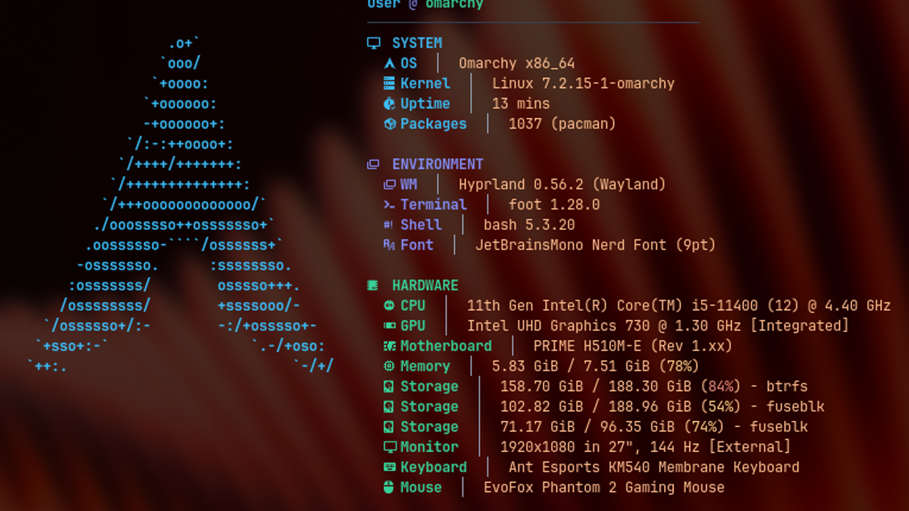

# Cyber Fastfetch Theme

An electric cyan and neon violet Fastfetch theme for [Omarchy](https://omarchy.org/), with a custom Arch ASCII logo and hardware grouped into SYSTEM, ENVIRONMENT, and HARDWARE sections.



## Requirements

- Omarchy with the Quattro shell (`panel` plugin support).
- `fastfetch`.
- A **Nerd Font** for the section and module icons.

The plugin does not use the network, does not require root, and starts no background service.

## Install

From the plugin marketplace page, or directly:

```bash
omarchy plugin add https://github.com/Adicodes270/cyber-fastfetch-theme.git --enable
```

## Open the panel

```bash
omarchy-shell shell toggle aditya27003.cyber-fastfetch
```

To keep it on a keybinding, add this to `~/.config/hypr/bindings.lua`:

```lua
o.bind("SUPER + CTRL + F", "Cyber Fastfetch", { panel = "aditya27003.cyber-fastfetch" })
```

The panel opens as a small floating window. Press `Esc` or the window close button to dismiss it.

## Use

- **Apply Theme** (`A`) installs the preset.
- **Restore Backup** (`R`) puts your previous config back.

Applying the theme writes two files:

| File | Purpose |
| --- | --- |
| `~/.config/fastfetch/config.jsonc` | The theme preset |
| `~/.config/fastfetch/cyber_logo.txt` | The Arch ASCII logo |

Before the first apply, your existing `config.jsonc` is copied to `~/.config/fastfetch/backup/config.jsonc.bak`. The backup is created once and is never overwritten by later applies, so Restore always returns your original setup.

After applying, run `fastfetch` in a terminal to see it.

## Remove

Restore your config first, then remove the plugin:

```bash
omarchy plugin remove aditya27003.cyber-fastfetch
```

Removing the plugin does not delete the files it installed; use **Restore Backup** before removing it.

## Troubleshooting

- **The panel does not open:** confirm the plugin is enabled with `omarchy plugin list --json | jq '.[] | select(.id == "aditya27003.cyber-fastfetch")'`, then run `omarchy-shell shell rescanPlugins`.
- **Icons show as boxes:** install a Nerd Font and select it in your terminal.
- **`fastfetch` is not found:** install `fastfetch` with your package manager and reopen the panel.

## License

MIT — see [LICENSE](LICENSE).

Author: **Aditya Kumar** ([@Adicodes270](https://github.com/Adicodes270))
